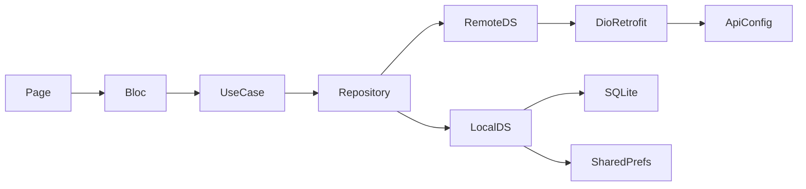

# Architecture

## Pattern

Clean Architecture por feature + **BLoC / Cubit** en presentation.

```text
feature/
  data/
    datasources/     # remote (Retrofit/Dio) + local (SQLite / prefs)
    models/
    repositories/    # *RepositoryImpl
  domain/
    entities/
    repositories/    # abstract contracts
    usecases/
  presentation/
    bloc/ | cubit/
    pages/
    widgets/
```

### Request → UI



## Consistency notes (reality)

- Features con capas completas: `pos`, `auth`, `stock`, `app_update`.
- `splash` solo tiene `presentation/` (usa use cases de `app_update`).
- `customer_display` es service-driven (sin BLoC/UseCase clásicos).
- Varios BLoCs/Cubits inyectan **DataSources o Repositories** directo (no solo UseCases), p. ej. `CheckoutBloc`, `ProductBloc`, `ClientsBloc`, `RefundsCubit`.
- Datasources Retrofit a menudo resuelven el `*Service` vía `di.sl<*Service>()` en el constructor.
- Auth presentation folder typo: `lib/features/auth/prensetation/` (no renombrar sin tarea explícita).

## Dependency injection

Archivo: [`lib/injection_container.dart`](../lib/injection_container.dart) — `GetIt.instance` (`sl`), `Future<void> init()`.

| Tipo | Registro típico |
|------|-----------------|
| BLoC / Cubit | `registerFactory` (salvo `PriceListTypesBloc`, `PdvConfigBloc` → lazy singleton) |
| UseCases, Repos, DataSources, Retrofit services | `registerLazySingleton` |
| SharedPreferences, DioClient, DatabaseHelper, Uuid | singletons / awaited en `init()` |

Ramas por plataforma en DI:

- **Printer:** web → `PrinterWebDatasource`; else socket + built-in.
- **Customer display:** Windows → `WindowsCustomerDisplayService`; Android → `AndroidCustomerDisplayService`; else `NoOpCustomerDisplayService`.

Algunos BLoCs se crean en el árbol de widgets (no GetIt): p. ej. `ProductLabelsBloc`, `CheckoutConfirmationCubit`, `ThemeCubit`.

`main.dart` provee un `MultiBlocProvider` global (Theme, Splash, Auth, Product, Cart, Ui, SavedOrders, Reports, Clients, Printer, PaymentMethods, PdvConfig, Checkout).

## Network

- Base URL **por empresa**: Firestore `enterprisesLicense/{id}` → `pointOfSaleUrlList` / `pointOfSaleUrl`, cache en SharedPreferences.
- Estado en [`lib/core/config/api_config.dart`](../lib/core/config/api_config.dart): `updateCompanyConfig`, `switchToNextBaseUrl`.
- Interceptors: base URL dinámica + `Authorization: Bearer`.
- Failover selectivo: `BaseUrlFailover.runWithFailover` en login cajero, tickets, returns, refunds cash, stock dispose writes. Detalle en [endpoints.md](endpoints.md).

Dart-defines relevantes: `GOOGLE_CLIENT_ID`, `GOOGLE_CLIENT_SECRET`, `FIRESTORE_PERSISTENCE`.

## Code generation

Tras tocar modelos Retrofit / Freezed / json_serializable:

```bash
fvm flutter pub run build_runner build --delete-conflicting-outputs
```

## Conventions

| Regla | Práctica actual |
|-------|-----------------|
| Símbolos en inglés | Preferido; el código mezcla español/Spanglish en modelos y nombres |
| Versiones fijas en `pubspec.yaml` | Casi siempre; excepción conocida: `path: ^1.9.0` |
| FVM | Obligatorio para Flutter/Dart commands |
| Comentarios | Muchos en español |

No “arreglar” typos de carpetas ni renombres masivos salvo pedido explícito.
